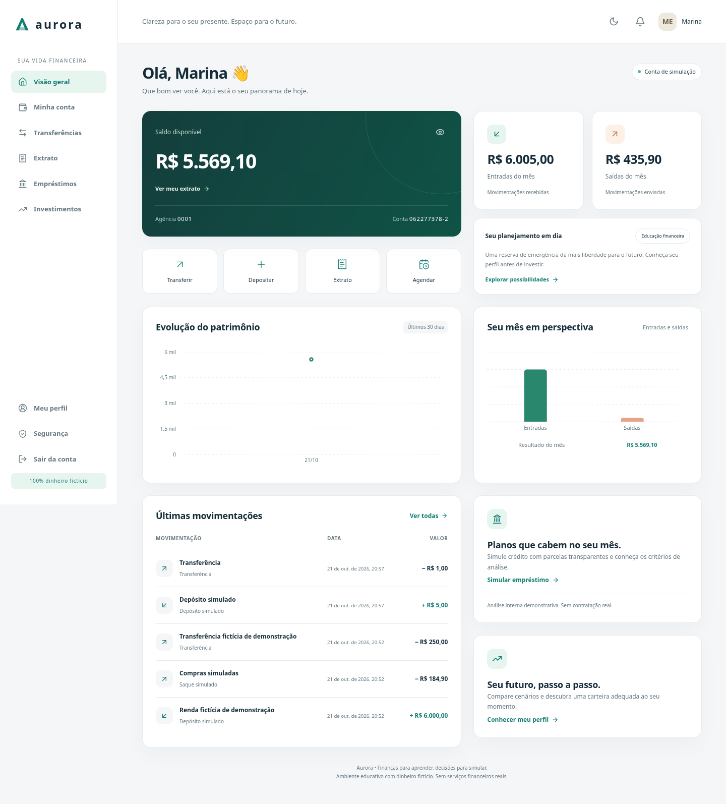

# Aurora — banco digital de simulação

Monorepo com API Ruby on Rails, aplicação web Next.js e aplicativo Expo para Android e iOS. **Todo dinheiro é fictício.** Não há Pix, cartões, execução de investimentos, consulta a bureaus ou conexão com instituições financeiras.

O código implementa os módulos das fases 1 a 7. A Fase 8 registra os testes efetivamente executados, os builds e os limites da entrega em [docs/phase-8-validation.md](docs/phase-8-validation.md). Builds assinados, publicação nas lojas e implantação pública exigem contas, certificados e revisão operacional; não são inferidos de um build local.

> **Relatório do projeto:** [entenda o que foi construído, como funciona, como executar e quais limites permanecem](docs/relatorio-do-projeto.md).

> **Primeiro teste no Windows:** [guia passo a passo para baixar o ZIP, iniciar no VS Code e testar com Marina e Lucas](docs/guia-windows.md).

## Stack e estrutura

- Ruby 3.4.11; Rails 8.1; PostgreSQL 17; Redis 7; Sidekiq/Active Job; RSpec.
- Next.js 15, React, TypeScript, Tailwind e Recharts; BFF com cookies HttpOnly e proteção de origem/CSRF.
- React Native/Expo, TypeScript, SecureStore e autenticação biométrica local opcional.
- Docker Compose, GitHub Actions, OpenAPI e XLSX com caxlsx.
- Versões resolvidas nos lockfiles de cada aplicação. A versão do SDK Expo está em [mobile/package.json](mobile/package.json).

```text
banco-digital/
├── backend/          # API, serviços, migrations, livro-razão e RSpec
├── web/              # Aplicação Next.js e BFF de autenticação
├── mobile/           # Aplicativo Expo Android/iOS
├── docs/             # Contrato, arquitetura, checkpoints e segurança
├── infra/            # Orientações de operação e configuração de testes
├── scripts/          # Inicialização e verificações locais
├── docker-compose.yml
└── .env.example
```

## Inicialização no VS Code — Docker

Instale Git, VS Code e Docker Desktop com Compose v2. No Windows, habilite WSL2 e Linux containers. Não é necessário instalar Ruby, PostgreSQL ou Redis no host para este fluxo.

PowerShell, dentro da pasta extraída/clonada:

```powershell
Set-Location C:\caminho\banco-digital
code .
.\scripts\setup.ps1
.\scripts\test.ps1
```

Bash/WSL2/macOS/Linux:

```bash
bash scripts/setup.sh
bash scripts/test.sh
```

O setup preserva um `.env` existente; na primeira execução gera credenciais locais aleatórias. Constrói as imagens, aplica migrations e inicia web, API, PostgreSQL, Redis, worker e scheduler.

- Web: http://localhost:3000
- API: http://localhost:3001/api/v1
- Saúde do processo: `/up`; saúde das dependências: `/api/v1/health`.
- As portas são configuráveis por `WEB_PORT`, `API_PORT`, `POSTGRES_PORT` e `REDIS_PORT`.

```bash
docker compose ps
docker compose logs --follow api worker scheduler
docker compose stop
```

`stop` preserva os volumes. Não apague volumes como tentativa automática de corrigir falhas. Não versione `.env`, mensagens de e-mail, tokens ou dados reais.

## Primeiro uso e dados fictícios

Cadastre-se na interface web, usando CPF de teste com dígitos verificadores válidos, data de nascimento de maior de idade, telefone E.164 (`+5511999990000`) e endereço fictício. Verifique o e-mail antes do login. Em desenvolvimento as mensagens são gravadas em `backend/tmp/mails`; o worker precisa estar em execução. Os links abrem as telas de verificação/recuperação da aplicação web.

Também existe uma carga opcional. No `.env`, escolha uma senha exclusiva de teste em `DEMO_PASSWORD` (12–128 caracteres) e configure `RUN_DEMO_SEEDS=1`. Execute:

```bash
docker compose run --rm api bundle exec rails db:seed
```

A carga cria `marina@example.test` e `lucas@example.test`, ambos verificados, com a senha escolhida. Abre contas e registra renda, uma despesa e uma transferência **fictícias pelo livro-razão**, com chaves idempotentes. Não cria administrador. Depois remova `DEMO_PASSWORD` e volte `RUN_DEMO_SEEDS=0`. Nunca reutilize senha pessoal; seeds de demonstração são proibidas em produção.

Um CPF com checksum válido não prova identidade e pode coincidir com um número real. Não utilize dados pessoais reais nesta demonstração.

## Funcionalidades

- Cadastro, perfil próprio, e-mail, recuperação de senha, sessões revogáveis, refresh rotativo e detecção de replay.
- MFA TOTP com segredo criptografado, códigos de recuperação de uso único e confirmação adicional para operações de risco.
- Abertura, consulta, bloqueio preventivo e encerramento de conta; depósitos e saques simulados; transferências internas; agendamentos; extrato filtrado e comprovantes.
- Livro-razão de partidas dobradas com centavos inteiros, ACID, locks em ordem determinística, idempotência, constraints e triggers PostgreSQL, reconciliação e lançamentos compensatórios.
- Cancelamento de agendamentos pendentes. Estorno pelo cliente somente de seus próprios depósitos/saques simulados elegíveis em até 24 horas. Transferências concluídas não podem ser desfeitas unilateralmente pelo remetente.
- Regras explicáveis de limite diário, valores elevados, tentativas repetidas, suspensão temporária e revisão administrativa.
- Crédito educativo: capacidade de pagamento, histórico interno, saldo médio, regras versionadas, Sistema Price, CET estimado com premissas, histórico e contestação. Aprovação não desembolsa dinheiro.
- Investimentos educativos: perfil, reserva de emergência, oito classes de ativos, produtos com taxas fictícias, aportes, cenários, carteira diversificada e objetivos. Não há promessa de retorno ou execução de ordens.
- Dashboard, notificações, modo claro/escuro, formulários acessíveis e confirmações das operações.
- Administração separada com MFA obrigatório, revisão de crédito/fraude, regras, logs e relatórios XLSX auditados e protegidos contra fórmulas.



## Administrador

O cadastro público sempre cria cliente. Para promover um usuário de demonstração, primeiro cadastre-o, verifique o e-mail e ative MFA pela interface. Então execute o comando interativo:

```bash
docker compose exec api bundle exec rails admin:create
```

O comando solicita o e-mail, verifica os requisitos, registra auditoria e revoga as sessões. Faça login novamente com segundo fator e acesse `/admin`. Administração e exportações exigem confirmação MFA recente. Códigos TOTP já usados não podem ser repetidos: aguarde o próximo código ou utilize uma credencial de recuperação ainda válida. Não existe edição arbitrária de saldos no painel.

## Mobile — Android e iOS

Instale uma versão Node compatível com o SDK indicado em `mobile/package.json`, use `npm ci` e siga [mobile/README.md](mobile/README.md):

```powershell
Set-Location mobile
Copy-Item .env.example .env
npm ci
npx expo start
```

O celular físico não acessa o `localhost` do computador. Na configuração local, use `EXPO_PUBLIC_API_URL=http://IP_DA_MAQUINA:3001`. No `.env` da raiz, configure `API_BIND_HOST` com esse IP exato e acrescente-o a `APP_HOSTS`; recrie a API. Permita acesso somente na rede de testes confiável. Preserve PostgreSQL e Redis em loopback. Android Emulator normalmente usa `10.0.2.2`; iOS Simulator usa o localhost do Mac.

Biometria depende do dispositivo; o login e MFA continuam sendo decisões do servidor. Tokens ficam no SecureStore. Expo Go e dispositivos físicos têm limitações distintas de biometria/Face ID, documentadas no mobile. Builds assinados usam os perfis de `mobile/eas.json`, com credenciais próprias de Android/Apple. Não há chave privada de assinatura no repositório.

## Desenvolvimento nativo — Ruby, PostgreSQL e Redis

No Windows, prefira WSL2: abra a pasta pelo VS Code com `WSL: Reopen Folder in WSL`. Não misture gems Windows/Linux. Exemplo Ubuntu, com rbenv ainda não instalado:

```bash
sudo apt-get update
sudo apt-get install -y build-essential git curl libssl-dev libyaml-dev zlib1g-dev libffi-dev libreadline-dev libpq-dev pkg-config
git clone https://github.com/rbenv/rbenv.git ~/.rbenv
git clone https://github.com/rbenv/ruby-build.git ~/.rbenv/plugins/ruby-build
export PATH="$HOME/.rbenv/bin:$PATH"
eval "$(rbenv init - bash)"
rbenv install 3.4.11
cd backend
rbenv local 3.4.11
gem install bundler
bundle install
```

Persista a inicialização do rbenv em `~/.bashrc` conforme sua documentação. Instale e inicie PostgreSQL 17, seu cliente (`psql`/`pg_dump`) e Redis 7. Crie papel e bancos locais separados:

```bash
sudo -u postgres createuser --createdb --pwprompt banco
createdb -h 127.0.0.1 -U banco banco_digital_development
createdb -h 127.0.0.1 -U banco banco_digital_test
```

Copie `.env.example` para `.env` na raiz, substitua os placeholders e ajuste `DATABASE_URL`, `TEST_DATABASE_URL`, `REDIS_URL` e `SECRET_KEY_BASE`. Gere o segredo com `bundle exec rails secret`; não o publique. O Compose lê `.env`, mas Rails nativo não o carrega automaticamente.

Em cada terminal Bash/WSL2, a partir da raiz:

```bash
set -a
. ./.env
set +a
cd backend
bundle exec rails db:prepare
bundle exec rails server -b 127.0.0.1 -p 3001
```

Em outros terminais, carregue o mesmo ambiente a partir da raiz e entre em `backend/`, como no bloco anterior. Dentro de `backend/`, execute um processo por terminal:

```bash
bundle exec sidekiq -C config/sidekiq.yml
bundle exec rails runner 'Banking::Scheduler.run!'
```

O scheduler recupera agendamentos vencidos mesmo após perda de enfileiramento. Para o frontend, abra outro terminal na raiz do monorepo:

```bash
cd web
cp .env.example .env.local
npm ci
npm run dev
```

`API_URL` é configuração do servidor Next; não exponha tokens em variáveis públicas. Configure `WEB_ORIGIN` para a origem exata da aplicação.

## Testes, crash e segurança

Bancos de teste devem terminar em `_test`; a inicialização recusa outros nomes como proteção contra enganos. Nunca use dados que deseja preservar nesses bancos.

```bash
bash scripts/test.sh
docker compose run --rm test bundle exec brakeman --no-pager
docker compose run --rm test bundle exec bundler-audit check --update
docker compose exec api bundle exec rails banking:reconcile
```

Para execução nativa, carregue `.env`, defina `RAILS_ENV=test`, `DATABASE_URL=$TEST_DATABASE_URL`, Redis de teste separado, e execute `bundle exec rails db:prepare && bundle exec rspec` dentro de `backend/`.

```bash
cd web
npm ci
npm run typecheck
npm test
npm run build
# Com API e web iniciadas e usuário de teste configurado:
npm run test:e2e
cd ../mobile
npm ci
npm run typecheck
npm test
npm run export
```

A CI contém as verificações correspondentes. Veja [docs/phase-8-validation.md](docs/phase-8-validation.md) para comandos, resultados, falhas corrigidas, testes de concorrência/crash e limites de validação. Scanners de dependências representam o banco de avisos consultado naquela data e não certificam a aplicação.

## Segurança e produção

A arquitetura e o modelo de dados estão em [docs/architecture.md](docs/architecture.md) e [docs/data-model.md](docs/data-model.md). API e contrato: [docs/api.md](docs/api.md) e [docs/openapi.yaml](docs/openapi.yaml). Checkpoints: [docs/roadmap.md](docs/roadmap.md).

O Compose padrão é local. Produção exige TLS, hosts/origens explícitos, SMTP validado, permissões restritas no PostgreSQL, Redis protegido, segredos próprios, três chaves de Active Record Encryption, observabilidade, retenção/LGPD, backups e recuperação testada. `.env.production.example` é um inventário sem segredos, não uma implantação automaticamente aprovada.

Consulte a verificação ASVS/API Top 10/MASVS e os controles que ainda exigem revisão humana em [docs/security.md](docs/security.md). O sistema não é certificado como banco e não é 100% seguro. Não habilite operações reais sem homologação, análise regulatória e integração com instituições autorizadas.

## Problemas comuns no Windows

- Docker indisponível: inicie o Docker Desktop, confira WSL2/Linux containers e `docker info`.
- Porta ocupada: ajuste as variáveis de portas; atualize também `APP_FRONTEND_URL`, `WEB_ORIGIN` e o endereço da API no app.
- Script PowerShell bloqueado: use os comandos Compose equivalentes ou uma política apenas para o processo, conforme as regras da sua máquina; não altere a política global sem necessidade.
- Arquivo shell com CRLF: use os scripts PowerShell ou salve `.sh` com LF.
- Falha de compilação `pg`/Argon2: use Docker ou instale compilador e bibliotecas no mesmo WSL do Ruby.
- Autenticação PostgreSQL após mudar `.env`: credenciais de um volume existente não são alteradas automaticamente; preserve os dados e ajuste o papel local.
- E-mail não chega: o worker precisa executar; desenvolvimento entrega arquivos em `backend/tmp/mails`, sem provedor externo.
- Celular recebe bloqueio de Host: inclua o IP de testes em `APP_HOSTS` e confira `API_BIND_HOST`; não abra os bancos na rede.
- Login admin/MFA falha com código recém-usado: a proteção de replay é intencional; use o próximo intervalo TOTP.
