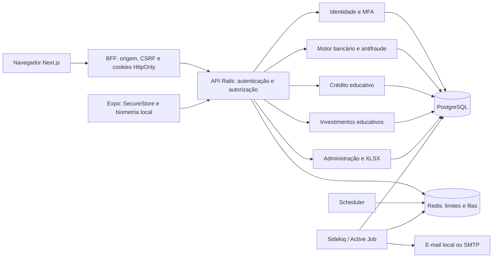

# Arquitetura Aurora

Aurora é uma fintech de simulação com monorepo Rails/Next.js/Expo. O monólito modular preserva uma única fronteira ACID para operações contábeis; interfaces e processamento assíncrono não substituem a autoridade do backend. Não há integrações financeiras reais.

## Responsabilidades e fonte de verdade

Controllers interpretam HTTP, autenticam, limitam parâmetros e procuram recursos no escopo correto. Services coordenam casos de uso, locks, validações e auditoria. Models validam domínio e relações; PostgreSQL adiciona unicidade, FKs, checks e triggers. Jobs recebem identificadores e executam os mesmos serviços autorizados, sem alterar saldos por uma via paralela.

PostgreSQL mantém identidade, sessões, contas, livro-razão, produtos educativos, regras e auditoria. Redis mantém controles de taxa, filas e o lease do scheduler; não contém a fonte do saldo. Falha de Redis não habilita uma operação sensível: o limitador lança a falha, em vez de retornar autorização permissiva.

A configuração SQL em `db/structure.sql` preserva funções e triggers. Migrations são a evolução do schema. A compensação sistêmica também pode ser inicializada de forma concorrente após carga apenas de estrutura, sem depender de dados implícitos no dump.

## Fronteira financeira

Cada cliente possui no máximo uma conta digital e uma conta contábil de passivo. Há uma conta de ativo para compensação simulada. Depósito registra débito na compensação/crédito no passivo do cliente; saque inverte esses lados; transferência debita o passivo de origem e credita o de destino.

O motor usa centavos inteiros, valores positivos, transação PostgreSQL e savepoint próprio. Bloqueia usuários e contas envolvidos em ordem de UUID e revalida sessão, estado, saldo e limites sob esses locks. A idempotência é única por usuário e chave, vinculada ao digest da intenção; dados diferentes com a mesma chave produzem conflito.

Triggers diferíveis verificam no commit que cada transação tem pelo menos dois lançamentos, débito igual a crédito e totais iguais ao valor registrado. Outros triggers conferem `available_cents + blocked_cents` contra o livro-razão. Registros contábeis não podem ser atualizados/excluídos pelas operações normais. Estorno elegível cria transação compensatória e referência única ao original.

O saldo na conta é um cache operacional conferido pelo ledger, não um campo administrativo editável. Bloqueio reclassifica disponível em bloqueado, mantendo total; liberação administrativa restaura a classificação. Encerramento exige saldo total zero e ausência de agendamento pendente. A reconciliação detecta divergências e bloqueia contas afetadas para revisão, sem inventar ajustes.

## Agendamentos, fraude e falhas

Agendar não reserva saldo. A linha persistida conserva destino, valor, vencimento, estado e chave idempotente; execução revalida regras e registra resultado. O scheduler consulta vencidos a cada 30 segundos com lease Redis de 20 segundos. Agendamentos sem enfileiramento recente podem ser reenviados após cinco minutos. Jobs duplicados não duplicam dinheiro.

As regras de fraude são explicáveis: limite diário, valor elevado, repetição de rejeições e cooldown temporário. Uma saída de pelo menos 100000 centavos é atípica quando excede três vezes a média inteira das últimas até 20 saídas, com amostra mínima de cinco. Novas contas não recebem histórico inventado. Risco elevado exige MFA recente; eventos e justificativas seguem para revisão administrativa.

Falha entre débito e crédito deve abortar a operação inteira. A validação inclui concorrência real e encerramento da conexão PostgreSQL no meio do lançamento, conforme [Fase 2](phase-2.md). Essa evidência não substitui testes de falha de infraestrutura completa, restauração, disco e recuperação de desastre.

## Identidade, canais e administração

Senhas usam Argon2id. Tokens opacos possuem hashes persistidos, TTL, rotação e revogação por família. Verificação e recuperação usam tokens distintos e de uso único. MFA TOTP tem segredo criptografado com Active Record Encryption, proteção de replay e códigos de recuperação com hash. Operações sensíveis revalidam usuário/sessão sob lock, impedindo reutilizar estado de uma sessão revogada durante uma requisição.

A web guarda tokens em cookies HttpOnly e usa BFF com verificação de origem/CSRF; o mobile usa SecureStore e renovação serializada. Biometria protege a apresentação local, enquanto autenticação, MFA e autorização continuam no servidor. O BFF possui coordenação de refresh somente dentro de um processo; múltiplas réplicas exigem coordenação distribuída.

Administração exige papel próprio, MFA e confirmação recente. Regras são whitelisted e auditáveis; relatórios XLSX selecionam colunas permitidas e limitam volume. Não há edição arbitrária de saldo. Promoção administrativa é um comando local interativo para usuário ativo, verificado e com MFA.

## Produtos educativos

Crédito combina renda disponível, despesas, dívida estimada/declarada, relacionamento, histórico interno e saldo médio observado. Regras versionadas geram snapshots de decisão, Price, cronograma e CET estimado com premissas. Revisão e contestação não desembolsam dinheiro nem alteram condições históricas da solicitação.

Investimentos cruzam capacidade financeira, reserva, liquidez, prazo, conhecimento e tolerância. Perfis, oito classes, taxas fictícias, carteira, aportes e cenários são educativos. Projeções são limitadas para evitar valores fora da representação segura; não executam ordens ou prometem retorno.

## Operação e fronteiras pendentes

O Compose fornece web, API, PostgreSQL, Redis, Sidekiq e scheduler locais. Produção tem configuração separada e exige segredos exclusivos, três chaves de criptografia, TLS, hosts/origens explícitos e SMTP. O banco local usa papel administrativo por conveniência; produção precisa separar migração e aplicação, restringindo DDL e acesso a evidências.

Retenção/LGPD, auditoria independente, operação de backups, dispositivos físicos, assinaturas Android/iOS e publicação dependem de validação externa. Alertas móveis sem correção upstream, CSP e refresh distribuído estão em [security.md](security.md). Evidências atuais ficam nos [checkpoints](roadmap.md) e na [Fase 8](phase-8-validation.md).
