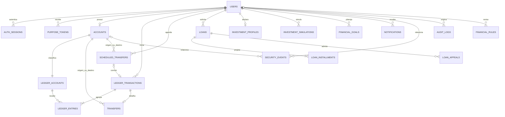

# Modelo de dados

PostgreSQL é a fonte persistente. As entidades principais usam UUID; dinheiro usa `bigint` em centavos e taxas usam decimal exato. Redis não contém o saldo principal. O diagrama resume relações e omite campos auxiliares; migrations e `backend/db/structure.sql` definem o schema físico completo.

`credit_rules` armazena configurações versionadas; cada `loan` preserva `rule_version` e `eligibility_snapshot`. A conta contábil sistêmica de compensação tem `account_id` nulo e tipo ativo; contas contábeis de cliente têm proprietário e tipo passivo. A relação do diagrama com `accounts` não inclui essa conta sistêmica.

## Identidade e credenciais

| Tabela | Conteúdo e integridade |
| --- | --- |
| `users` | Cadastro fictício, CPF/e-mail únicos, nascimento, contato/endereço, profissão, renda/despesas/dívida em centavos, perfil, papel e status |
| `auth_sessions` | Usuário, hashes SHA-256 de access/refresh, família, expirações, revogação, último uso e confirmação MFA |
| `purpose_tokens` | Usuário, propósito permitido, hash único, expiração e consumo |
| `audit_logs` | Ação, usuário opcional, referência de objeto/requisição e criação; sem payload completo ou credenciais |

Senha humana usa Argon2id; SHA-256 é usado para tokens/códigos aleatórios de alta entropia. `users` também contém segredo MFA ativo/pendente criptografados, expiração da matrícula, passo TOTP consumido e hashes de até oito códigos de recuperação. Produção exige chaves de Active Record Encryption próprias e protegidas.

A API própria mascara CPF e não retorna hashes, segredos ou códigos já consumidos. O campo `role` é apresentado como indicador da interface; atribuição pública de papel não é permitida. CPF, nascimento e e-mail não são alterados pelo endpoint cadastral. Comprometimento de renda é calculado para apresentação; não substitui a análise de crédito.

Dados cadastrais, contato e finanças declaradas permanecem em campos normais do PostgreSQL; não há criptografia de campo genérica para todo dado pessoal. Criptografia de volumes/backups, permissões, retenção e LGPD precisam de desenho operacional, especialmente antes de receber dados reais.

## Contas, razão e cache de saldo

| Tabela | Invariantes relevantes |
| --- | --- |
| `accounts` | Um usuário por conta, número único, agência fictícia, estados `active/blocked/closed`, saldos e limite não negativos |
| `ledger_accounts` | Código único, ativo sistêmico ou passivo com conta proprietária; imutável após criação |
| `ledger_transactions` | Tipo, valor positivo, usuário, chave idempotente/digest, conclusão e referência única de estorno |
| `ledger_entries` | Transação, conta contábil, direção e centavos positivos; no máximo um lançamento por conta na transação |
| `transfers` | Transação única, contas de origem/destino diferentes; registro histórico imutável |
| `scheduled_transfers` | Contas/usuário, valor, vencimento com fuso, intenção idempotente, estado, enfileiramento e resultado |

Cada transação exige ao menos dois lançamentos, soma de débito igual à de crédito e ambas iguais ao valor registrado. Triggers PostgreSQL diferíveis verificam isso no commit e comparam o total disponível+bloqueado ao passivo contábil do cliente. Alterações/exclusões de lançamentos, transações, contas contábeis e detalhes de transferência são barradas por triggers e controles dos models.

Uma atualização de estado sem mudança dos valores monetários pode bloquear uma conta que já esteja divergente, preservando o cache encontrado e a evidência de reconciliação. Isso não autoriza uma alteração de saldo: atualizações monetárias continuam sujeitas à comparação contábil no commit.

`available_cents` e `blocked_cents` são buckets do mesmo passivo. Bloquear conta reclassifica o valor sem criar dinheiro; desbloqueio administrativo o libera. Nenhuma API de perfil ou painel aceita gravar saldo arbitrariamente. A reconciliação usa o livro-razão, reporta divergências e bloqueia contas afetadas em vez de aplicar um ajuste silencioso.

Estorno elegível referencia o original por `reverses_id` único e cria lançamentos inversos; nunca edita a transação anterior. Transferências concluídas não admitem estorno unilateral do cliente. Agendamentos não representam dinheiro reservado; `completed` exige referência ao lançamento e falhas/cancelamentos preservam o registro.

## Crédito educativo

`credit_rules` tem versão única e índice parcial para apenas uma regra ativa. A configuração é validada por chaves e limites; ativação cria uma versão e registra auditoria. Uma solicitação preserva as condições e decisão originais, mesmo quando a regra muda.

`loans` mantém valor, prazo, taxa decimal, parcela/custo, status, snapshot explicável, versão, intenção idempotente e revisão administrativa. `loan_installments` conserva principal, juros, pagamento e saldo restante; constraints conferem a composição dos centavos. `loan_appeals` armazena contestação e resultado, com no máximo uma contestação pendente por solicitação.

Estados e parcelas são de simulação. Não existe desembolso na conta nem integração de cobrança. O motor usa apenas histórico interno disponível e informa quando não há pagamentos reais registrados; não inventa score externo ou consultas de crédito.

## Investimentos e objetivos

`investment_profiles` é único por usuário e preserva respostas, perfil, pontuação educativa, recomendações, reserva-alvo, valor estimado disponível e alertas. `investment_simulations` guarda entradas, taxa exata, resultados em centavos, projeções, cenários e carteira, com limites de prazo/valor. A interface não movimenta recursos.

`financial_goals` mantém nome, meta, prazo e estado de um objetivo próprio. A remoção permitida de um objetivo não é remoção de evidência contábil. As classes/rendimentos fictícios são catálogo educativo no código, não posições custodiadas ou títulos reais.

## Risco, notificações e regras

`security_events` conserva tipo, severidade, motivos, usuário/conta opcionais, estado e revisão administrativa. `notifications` guarda avisos do cliente e leitura. `financial_rules` permite somente chaves conhecidas de limites/risco, valor inteiro, versão e administrador responsável. Regras não aceitam código ou expressões executáveis.

Trilhas de auditoria não copiam senha, tokens, CPF completo ou payloads de cadastro. Logs de eventos de risco podem conter justificativas e classificações necessárias à revisão, acessíveis apenas a administradores autorizados. Os dois conjuntos têm políticas de retenção e acesso distintas a definir operacionalmente.

## Integridade, restauração e privilégios

Unicidade, FKs restritivas, checks e triggers complementam validações Rails e locks; validação somente no frontend não resolve concorrência. A carga de estrutura não contém dados de negócio; `LedgerAccount.clearing!` inicializa com segurança o registro sistêmico quando necessário, inclusive em primeiras operações concorrentes.

Triggers de auditoria rejeitam `UPDATE/DELETE`, mas não protegem contra superusuário que altere DDL ou trunque tabelas. A conta de aplicação em produção deve ter privilégios restritos e diferentes da conta de migração. Backups precisam preservar schema SQL, chaves de criptografia e dados de modo consistente, com restauração verificada. A política de retenção/LGPD não é resolvida por desativação lógica.
