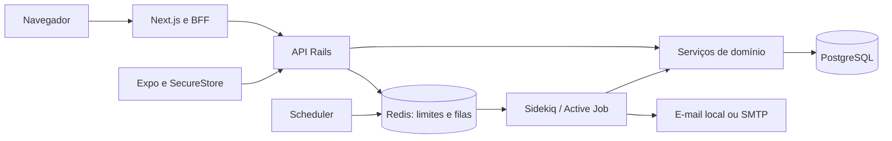

# Relatório do projeto Aurora

## 1. O que é o projeto

Aurora é um banco digital **de simulação**, organizado como monorepo: uma API Ruby on Rails, uma aplicação web Next.js e um aplicativo React Native/Expo para Android e iOS. O objetivo é demonstrar cadastro, autenticação, movimentações consistentes, planejamento financeiro e administração com dados e dinheiro fictícios.

O código implementa os módulos das fases 1 a 7. A Fase 8 registra a validação que foi possível executar. Não há Pix, cartões reais, custódia de ativos, desembolso de empréstimos, consulta ao Serasa/SPC/Banco Central ou conexão com instituições financeiras. Publicar o repositório não equivale a implantar um banco ou liberar o aplicativo para distribuição.

Este relatório explica como as partes se conectam. Os detalhes de instalação estão no [README principal](../README.md); a evidência completa está no [checkpoint de validação](phase-8-validation.md) e no [resumo estruturado](validation-summary.json).

## 2. Tecnologias e organização

| Parte | Tecnologias e função |
| --- | --- |
| Backend | Ruby 3.4.11, Rails 8.1.4, Active Record e API REST JSON |
| Dados persistentes | PostgreSQL 17, com migrations, índices, constraints e triggers |
| Trabalho assíncrono | Redis 7, Active Job e Sidekiq; scheduler para recuperar agendamentos |
| Web | Next.js 15, React, TypeScript, Tailwind e Recharts |
| Mobile | Expo SDK 58.0.17, React Native 0.88, TypeScript e SecureStore |
| Verificação | RSpec, testes TypeScript/Node, Playwright, Brakeman e auditorias de dependências |
| Execução e entrega | Docker Compose, scripts Bash/PowerShell, GitHub Actions e perfis EAS |

As versões resolvidas estão nos lockfiles. O backend mantém `connection_pool` na faixa 2.5, resolvida em 2.5.5, por compatibilidade verificada com Sidekiq 7.3.9; a incompatibilidade com a versão 3 foi encontrada durante o teste do worker real.

```text
banco-digital/
├── backend/
│   ├── app/controllers/   # HTTP, autenticação, escopo e respostas
│   ├── app/models/        # Entidades e validações
│   ├── app/services/      # Casos de uso financeiros e de segurança
│   ├── app/policies/      # Regras de acesso aplicáveis
│   ├── app/jobs/          # E-mails e execução assíncrona
│   ├── config/            # Rotas e ambientes separados
│   ├── db/                # Migrations, schema SQL e seeds fictícias
│   └── spec/              # Modelo, serviço, API e concorrência
├── web/                   # Telas, componentes e BFF Next.js
├── mobile/                # Navegação, telas e cliente seguro da API
├── docs/                  # Contrato, decisões, relatórios e checkpoints
├── infra/                 # Orientações de infraestrutura
├── scripts/               # Inicialização, testes e fixtures de CI
├── .github/               # Verificações automatizadas
├── docker-compose.yml
├── .env.example
└── README.md
```

## 3. Arquitetura e fonte de verdade

O backend é um monólito modular. Essa escolha mantém débito, crédito, saldo e auditoria dentro da mesma transação PostgreSQL, sem depender de uma transação distribuída entre serviços.



PostgreSQL é a fonte dos dados e do livro-razão. Redis atende filas, controles de taxa e coordenação do scheduler; não define saldo. O frontend apresenta dados e solicita operações, mas não concede acesso, aprova limites ou determina o resultado contábil.

O Compose inicia seis serviços: web, API, PostgreSQL, Redis, worker e scheduler. O mobile é iniciado separadamente e utiliza a mesma API. A [arquitetura detalhada](architecture.md) explica as responsabilidades e a [ADR inicial](decisions/0001-foundation.md) registra as decisões técnicas.

## 4. Cadastro, autenticação e canais

### Cadastro e sessões

O cadastro valida campos obrigatórios, CPF por checksum, e-mail, telefone E.164, maioridade e unicidade. CPF válido não comprova identidade: devem ser usados somente dados fictícios. Senhas são protegidas com Argon2id, sem persistência em texto puro. O e-mail precisa ser confirmado antes do login.

A autenticação usa access tokens opacos de 15 minutos e refresh tokens de 30 dias por emissão. O PostgreSQL guarda hashes das credenciais. O refresh é rotativo: a renovação invalida o par anterior, e a reutilização de um refresh consumido revoga sua família de sessões. Logout, recuperação de senha, revogação e desativação também alteram o estado no servidor.

Verificação de e-mail e recuperação de senha têm tokens separados, expiração e uso único. O worker gera o token e entrega a mensagem; ele não é colocado nos argumentos da fila. Em desenvolvimento os e-mails ficam em `backend/tmp/mails`, fora do Git.

### Navegador e BFF

O navegador chama o BFF Next em `/api/...`; o BFF encaminha para o Rails em `/api/v1/...`. Access e refresh ficam em cookies `HttpOnly`, `SameSite=Strict`, limitados a `/api`. Em HTTPS/produção usam `Secure`; a exceção sem `Secure` é restrita a HTTP loopback explicitamente configurado.

Mutações exigem origem exata e `X-Aurora-CSRF: 1`. O JavaScript recebe o estado de autenticação, sem os tokens utilizáveis. O projeto não guarda credenciais em localStorage. Refresh concorrente é agrupado dentro de um processo web; operar múltiplas réplicas exige coordenação distribuída adicional.

### Aplicativo mobile

O cliente mobile acessa o Rails diretamente e guarda tokens no SecureStore. Serializa refresh e gravação de credenciais para impedir que uma resposta antiga restaure uma sessão encerrada. As intenções financeiras preservam a chave de idempotência antes do envio, inclusive após falha ou reinício.

A biometria é um bloqueio local opcional ao retomar a aplicação. Ela não substitui autenticação ou MFA no servidor. Os detalhes de armazenamento, rede LAN e comportamento diante de falhas estão no [README mobile](../mobile/README.md).

### Segundo fator e administração

MFA usa TOTP de seis dígitos, segredo criptografado e controle de replay. A ativação entrega oito códigos aleatórios de recuperação, de uso único, persistidos apenas como hashes. Administração e movimentações de risco exigem confirmação recente de cinco minutos; renovar tokens não renova esse prazo.

O cadastro público cria cliente. A promoção a administrador é um comando local interativo para usuário ativo, verificado e com MFA, com auditoria e revogação das sessões. O backend continua verificando papel, propriedade, sessão e segundo fator em cada operação sensível.

## 5. Como o dinheiro fictício é movimentado

### Livro-razão de partidas dobradas

Valores monetários usam centavos inteiros. Por exemplo, R$ 100,00 correspondem a `10000`; taxas usam decimal exato. Não há autorização para ficar com saldo negativo.

A conta digital do cliente é associada a uma conta contábil de passivo: o saldo representa a obrigação simulada do banco com o cliente. Depósitos e saques usam uma conta sistêmica de compensação. Uma transferência de R$ 100,00 debita `10000` do passivo da origem e credita `10000` no passivo do destino.

Uma operação percorre estas etapas:

1. A API autentica a sessão e valida formato, propriedade, valor e chave de idempotência.
2. O serviço abre uma transação, bloqueia os usuários/contas envolvidos em ordem determinística e revalida sessão, estados, fundos, limites e risco.
3. Registra a transação e seus lançamentos de débito/crédito, atualiza o cache de saldo e cria as evidências de auditoria/notificação.
4. No commit, triggers diferíveis conferem partidas dobradas e correspondência entre livro-razão e saldo. Uma falha aborta a operação inteira.

`Idempotency-Key` identifica a intenção. Repetir a mesma chave com os mesmos dados devolve o registro original; usar a chave com outros dados produz conflito. Em caso de timeout ou resultado incerto, consultar o extrato e repetir a intenção original evita transformar uma tentativa em duas operações diferentes.

Lançamentos e transações contábeis não são editados ou apagados pelas operações normais. Estorno elegível cria lançamentos compensatórios, preservando o original. O cliente só pode estornar seus depósitos/saques simulados em até 24 horas, quando as demais regras permitem. Transferências concluídas não podem ser canceladas unilateralmente pelo remetente.

### Bloqueio, reconciliação e agendamentos

Bloqueio preventivo reclassifica o disponível como bloqueado; liberação administrativa faz o inverso. O total contábil não muda. Encerramento e desativação exigem saldos zerados e ausência de agendamentos pendentes.

A reconciliação compara cache e lançamentos. Ao encontrar divergência, registra evidência e bloqueia a conta, sem inventar um ajuste financeiro. Uma atualização apenas de estado pode bloquear uma conta já divergente; isso não libera uma alteração arbitrária de valor.

Agendar não reserva saldo. O job reavalia todas as regras ao executar. O scheduler consulta vencidos a cada 30 segundos e recupera enfileiramentos perdidos; a linha persistida e a idempotência impedem que um job repetido duplique dinheiro. Não há promessa de execução no segundo exato.

O [checkpoint bancário](phase-2.md) descreve as constraints, o controle de concorrência e os testes de crash.

## 6. Crédito e investimentos educativos

### Empréstimos

O motor considera renda disponível, despesas, prestação de dívidas declarada ou estimada, histórico interno, relacionamento e saldo médio observado. Dívida cadastrada é um estoque; a hipótese usada para estimar a despesa mensal é apresentada ao cliente. O sistema não usa apenas um múltiplo do salário.

A simulação calcula parcelas Price, cronograma, custo total, capacidade, limite estimado e score interno explicado. Taxas são fictícias. O CET estimado explicita tarifas, seguros e tributos zero, além de arredondamento; não é CET regulatório.

Solicitações preservam snapshot da decisão e da versão das regras. Administradores revisam com justificativa, e rejeições podem ser contestadas. Aprovação simulada não cria crédito na conta nem inicia cobrança. Veja [Fase 4](phase-4.md).

### Investimentos e metas

O questionário combina capacidade financeira, dívidas, reserva, objetivos, horizonte, liquidez, conhecimento e tolerância. Classifica perfil conservador, moderado ou arrojado e explica a alocação educativa. Reserva incompleta, prazo curto ou baixa disponibilidade podem restringir a exposição, mesmo com salário alto ou tolerância declarada elevada.

O catálogo contém Tesouro Selic, Tesouro IPCA+, CDB, LCI/LCA, fundos de renda fixa, FIIs, ETFs e ações, com riscos/liquidez e taxas fictícias identificados. Há projeção de aportes, comparação de cenários, carteira diversificada, histórico e objetivos. Não há promessa de rentabilidade, compra de ativos ou posições custodiadas. Veja [Fase 5](phase-5.md).

## 7. Administração, fraude e relatórios

A área administrativa é separada e exige papel autorizado, MFA ativo e confirmação recente. Permite consultar clientes, contas, movimentações, alertas, crédito e auditoria; revisar solicitações/alertas; gerenciar bloqueios e regras permitidas. Não existe edição arbitrária de saldos.

A prevenção simulada de fraude aplica limites por operação/dia, valores elevados, repetição de rejeições e cooldown. Também compara saídas com histórico suficiente: valor de pelo menos R$ 1.000,00, maior que três vezes a média inteira dos últimos até 20 débitos, com amostra mínima de cinco, exige confirmação adicional. Não se inventa histórico para uma conta nova.

Relatórios XLSX permitem filtros por período e até 5000 linhas. Exportam apenas colunas autorizadas, com cabeçalhos, datas, apresentação BRL e centavos inteiros. Textos são protegidos contra fórmulas. Senhas, tokens, segredos MFA e CPF completo não são exportados. A exportação é auditada. O catálogo de relatórios inclui contas/saldos, movimentações, empréstimos, análises, perfis e relatório financeiro. Veja [Fase 7](phase-7.md).

## 8. Dados e contrato da API

| Grupo | Entidades principais |
| --- | --- |
| Identidade | `users`, `auth_sessions`, `purpose_tokens` |
| Núcleo bancário | `accounts`, `ledger_accounts`, `ledger_transactions`, `ledger_entries`, `transfers`, `scheduled_transfers` |
| Crédito | `credit_rules`, `loans`, `loan_installments`, `loan_appeals` |
| Investimentos | `investment_profiles`, `investment_simulations`, `financial_goals` |
| Segurança/operação | `financial_rules`, `security_events`, `notifications`, `audit_logs` |

Índices, FKs, validações e constraints complementam os serviços transacionais. Dados cadastrais não possuem criptografia de campo generalizada; os segredos MFA possuem. Proteção de discos/backups, privilégios, retenção e LGPD são responsabilidades operacionais adicionais. O [modelo de dados](data-model.md) explica relações e integridade.

O contrato OpenAPI documenta **55 caminhos e 68 operações**. As famílias de recursos incluem `/auth/*`, `/me`, `/sessions`, `/security/*`, `/account`, `/transfers`, `/transactions`, `/scheduled_transfers`, `/dashboard`, `/notifications`, `/loans`, `/investment_*`, `/financial_goals` e `/admin/*`.

A API usa JSON, erros padronizados e escopo do usuário. Corpos são limitados a 32 KiB; operações monetárias exigem inteiros positivos e idempotência. Extrato tem filtros/paginação; recursos de outro cliente não se tornam acessíveis por conhecer seu UUID. Consulte o [guia da API](api.md) e o [OpenAPI](openapi.yaml) para payloads, respostas e limites exatos.

## 9. Como executar no VS Code

### Docker no Windows

Instale VS Code e Docker Desktop com WSL2/Linux containers. Na pasta do projeto:

```powershell
Set-Location C:\caminho\banco-digital
code .
.\scripts\setup.ps1
.\scripts\test.ps1
```

### Bash, WSL2, macOS e Linux

```bash
cd banco-digital
bash scripts/setup.sh
bash scripts/test.sh
```

O setup gera `.env` com segredos locais aleatórios na primeira execução e preserva um arquivo existente. Constrói as imagens, prepara o banco e inicia os serviços. A web usa `http://localhost:3000`; a API, `http://localhost:3001/api/v1`, salvo ajuste de portas.

```bash
docker compose ps
docker compose logs --follow api worker scheduler
docker compose exec api bundle exec rails banking:reconcile
docker compose stop
```

`stop` preserva os volumes. Não remova volumes para tentar corrigir erros automaticamente. `.env`, e-mails e credenciais de execução ficam fora do Git.

No primeiro uso, cadastre dados fictícios, confirme o e-mail local e abra a conta. A carga opt-in do README cria dois clientes verificados e operações fictícias pelo motor contábil; a senha é escolhida pelo operador, não uma credencial de execução privada publicada no repositório.

### Mobile

Com a API iniciada, use Node compatível com o SDK; a validação utilizou Node 24.19. No PowerShell:

```powershell
Set-Location mobile
Copy-Item .env.example .env
npm ci
npm start
```

Em Bash:

```bash
cd mobile
cp .env.example .env
npm ci
npm start
```

Configure `EXPO_PUBLIC_API_URL`. Android Emulator normalmente usa `http://10.0.2.2:3001`; iOS Simulator usa localhost do Mac. Aparelho físico usa o IP LAN do PC, acrescentado ao `APP_HOSTS` e configurado como `API_BIND_HOST` no ambiente local. Preserve PostgreSQL/Redis em loopback e use somente rede de testes confiável. Release exige HTTPS.

O [README mobile](../mobile/README.md) explica Expo Go, biometria, perfis EAS, credenciais de assinatura e rede. O [README web](../web/README.md) traz execução nativa e E2E; [infraestrutura](../infra/README.md) e [homologação](deployment.md) detalham operação e preparação de ambientes.

## 10. O que foi verificado

Resultados registrados no ambiente de validação, sem extrapolar para todas as máquinas ou versões futuras:

| Verificação | Resultado registrado |
| --- | --- |
| Rails/RSpec em Docker | **155 exemplos, zero falhas**, Ruby 3.4.11, Rails 8.1.4, PostgreSQL 17 |
| Web | Typecheck e build aprovados; **7 testes unitários** aprovados |
| Navegador Chromium com API real | **3 E2E** aprovados; nenhum erro de página observado |
| Mobile | Typecheck aprovado; **34 testes** aprovados |
| Expo | Compatibilidade e Doctor **20/20**; bundles Hermes Android/iOS gerados |
| Backend/dependências | Brakeman sem avisos/erros e bundler-audit sem vulnerabilidades conhecidas no snapshot consultado |
| Web/dependências de produção | `npm audit --omit=dev` sem alertas no snapshot consultado |
| Mobile/dependências | **15 alertas high abertos**, bloqueando a liberação de distribuição |

Os testes financeiros usaram conexões PostgreSQL independentes, pedidos duplicados, saques concorrentes, transferências opostas e falhas entre débito e crédito. Um teste encerrou a conexão real da operação nesse ponto e confirmou rollback de saldos/lançamentos. Também foi verificado bloqueio por reconciliação após corrupção privilegiada controlada do cache em um banco de teste.

Os canários reais verificaram entrega de recuperação pelo worker e uma transferência agendada com débito/crédito de um centavo. A queda forçada do Redis retornou 503 em saúde/login, sem emissão de tokens, seguida de recuperação para 200. Os fluxos web incluíram cookies, refresh concorrente, origem externa rejeitada, confirmação de operações, extrato/comprovante, simuladores, negação de administração ao cliente, MFA administrativo e download XLSX.

A varredura Gitleaks 8.30.1 dos 270 arquivos candidatos à publicação apresentou **nove achados**, revisados no contexto do código: uma senha fictícia exclusiva do E2E em banco efêmero, sete ocorrências em fixtures/assertivas do cliente mobile com rede e armazenamento simulados, e um nome de chave do SecureStore. Esses nove trechos não contêm credenciais reais; os alertas não foram suprimidos. Essa revisão específica não é garantia de ausência de outros segredos.

Comandos, correções e limites estão na [Fase 8](phase-8-validation.md). GitHub Actions foi configurado; execução local dos comandos não prova que um workflow remoto já rodou.

## 11. Limitações e bloqueios concretos

1. **Distribuição mobile bloqueada:** os 15 alertas high derivam de problemas ainda sem correção estável observada em `braces`/Metro e `node-forge`/Expo CLI. São caminhos do toolchain, mas isso não resolve os avisos. O job de segurança mobile falha em high/critical e preserva o relatório; o workflow completo não deve ser apresentado como verde enquanto o bloqueio existir.
2. **Sem binários assinados:** bundles Hermes não são APK, AAB ou IPA. Gradle/Xcode, assinatura, EAS, lojas e contas Apple/Google não foram executados com credenciais reais.
3. **Sem validação física:** biometria/PIN, SecureStore, lifecycle, acessibilidade nativa e comportamento Android/iOS precisam de aparelhos e testes reais. Não há garantia de ausência de crashes nativos.
4. **Sem implantação pública:** código no GitHub não disponibiliza um serviço bancário online. DNS, TLS, SMTP, secrets, backups e operação de um ambiente público continuam sob preparação/revisão própria. O Compose padrão é de desenvolvimento.
5. **Revisão de segurança ainda necessária:** CSP com nonces, coordenação distribuída de refresh, proxies confiáveis, privilégios do banco, retenção/LGPD, observabilidade e recuperação de desastre precisam de revisão independente. Há controles inspirados em ASVS, API Security Top 10 e MASVS, sem certificação.
6. **Limites de plataforma:** PowerShell foi revisado, mas não executado em Windows; testes locais não substituem validação naquela plataforma ou execução remota da CI.

Os avisos não foram ocultados, nem foram usados forks criptográficos sem revisão para declarar a aplicação segura. O [documento de segurança](security.md) conserva os riscos e o checklist humano. Nenhum teste, scanner ou relatório torna o sistema 100% seguro.

Qualquer evolução para dinheiro real depende de etapa posterior de homologação, análise regulatória e integração com instituições autorizadas.
